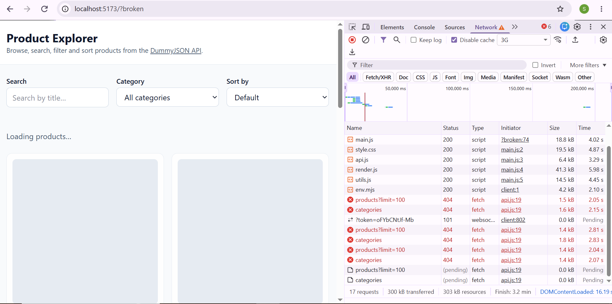
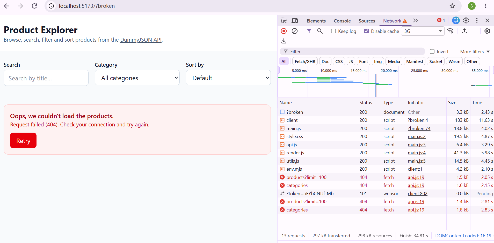
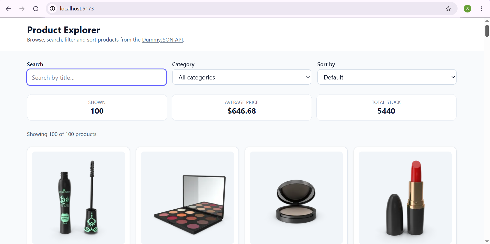
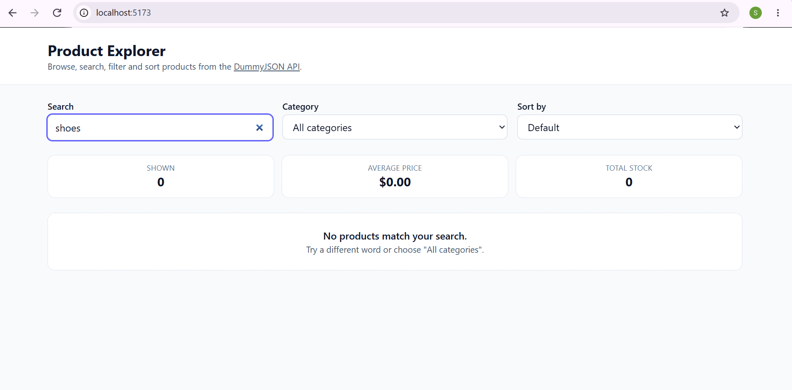

# Product Explorer — Week 5 Async Data Explorer

**Student:** SEBERA Isimbi Ange Thressy
**API:** [DummyJSON Products](https://dummyjson.com/docs/products)
**Live app:**https://async-data-explorer.netlify.app
**Video walkthrough:** 

A single-page app that loads products from a public API and lets you browse, search, filter and sort them. Built with HTML, Tailwind CSS v4 (Vite) and vanilla JavaScript (ES modules) using only the built-in `fetch`.

## Features

- Fetch on load with `async/await`
- Reusable `getJSON(url)` helper that checks `response.ok` and throws an `Error` with the status
- Loading state (skeleton cards with `animate-pulse`)
- Error state with friendly message and working **Retry** button
- Empty state when search/filter returns nothing
- Responsive card grid (1 → 2 → 3 → 4 columns) built with `map` and destructuring
- Live, case-insensitive search
- Category filter built from the unique values in the data
- Four sort options using `toSorted` (no mutation)
- Details modal (`<dialog>`) that fetches the single product by id
- Stats bar computed with `reduce` (shown count, average price, total stock)
- `Promise.allSettled` loads products + categories in parallel
- **Bonus:** debounced search (300 ms)

## State shape and state → render flow

```js
const state = {
  items: [],            // products from the API (never mutated)
  categoryNames: {},    // { slug: "Display Name" }
  status: "loading",    // "loading" | "success" | "error"
  error: null,
  query: "",
  filter: "all",
  sort: "default",
  details: { status: "idle", product: null, error: null },
}
```

Every event (typing, changing a select, clicking a card, Retry) **updates the state, then calls `render(state)`**. `render` calls the pure function `getVisibleItems(state)` to apply search, filter and sort to the data already in memory, then redraws the status message, controls, stats, grid and modal. Searching and sorting never re-fetch.

## Raw API JSON and how it is transformed

Shortened response from `GET https://dummyjson.com/products?limit=100`:

```json
{
  "products": [
    {
      "id": 1,
      "title": "Essence Mascara Lash Princess",
      "category": "beauty",
      "price": 9.99,
      "rating": 2.56,
      "stock": 99,
      "brand": "Essence",
      "thumbnail": "https://cdn.dummyjson.com/.../thumbnail.webp"
    }
  ],
  "total": 194, "skip": 0, "limit": 100
}
```

Transformations: `products` is pulled out with destructuring; `filter` + `toSorted` produce the visible list; `map` turns each product into card HTML (all text passed through `escapeHTML`); `reduce` computes the stats; `new Set(...map(category))` builds the filter options.

## Screenshots





## What I learned about async JavaScript


## Run locally

```bash
npm install
npm run dev      # development server
npm run build    # production build in dist/
```
